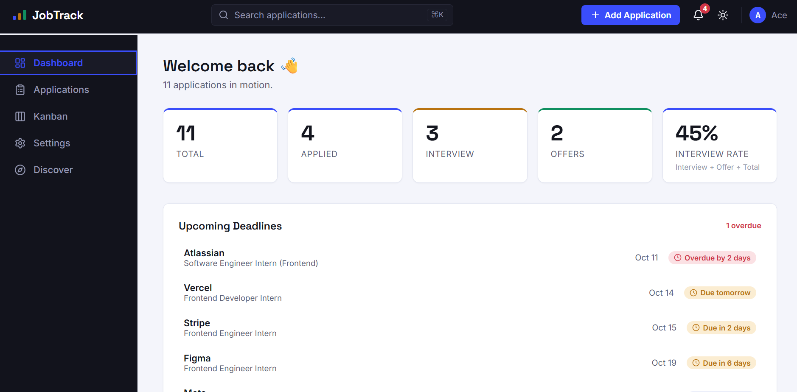
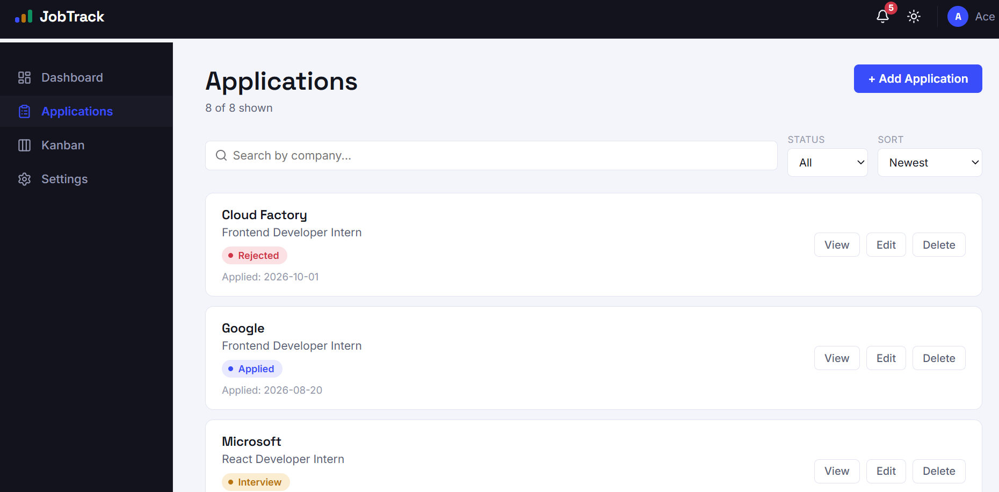
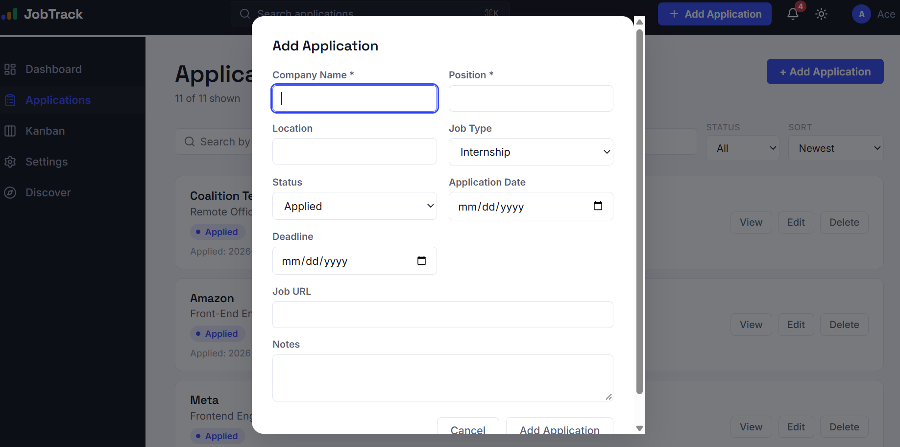
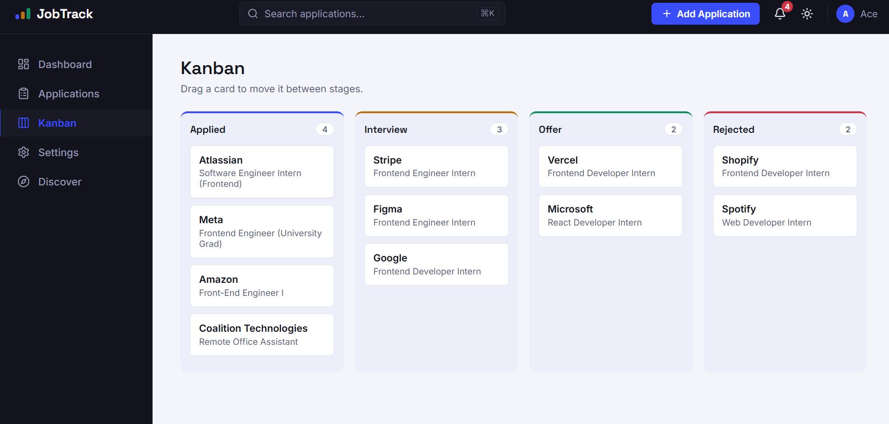
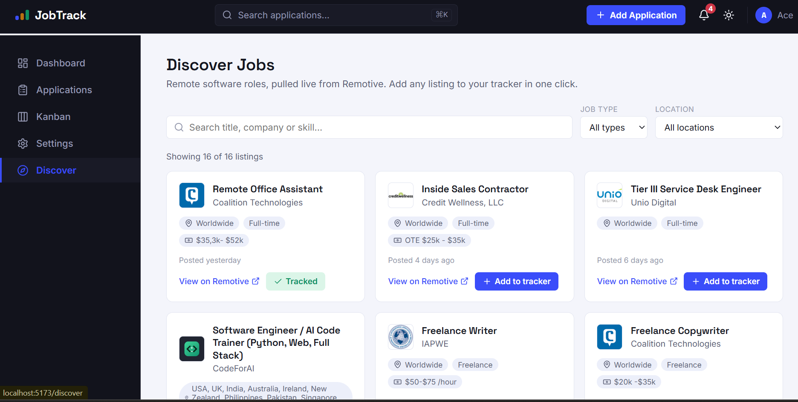

# JobTrack Web Application

A Kanban-style dashboard for tracking internship and job applications — built from scratch with React to practice component design, routing, state management, data fetching, and Context, and to have a real, working portfolio project rather than another to-do list clone.

**Live demo:** https://job-track-lake.vercel.app/

**GitHub repository:** https://github.com/aishmaskey23-ace/Job-Track-


> Built by [Aish Maskey](https://github.com/aishmaskey23-ace) as a self-directed learning project while studying frontend development.

## About

Job hunting means juggling dozens of applications across spreadsheets, emails, and sticky notes. JobTrack pulls all of that into one place: discover remote roles or add your own, then track each application through Applied → Interview → Offer / Rejected, with a dashboard summarizing where things stand, deadline reminders so nothing slips, and a Kanban board for a faster visual overview.

Your applications are stored in the browser via `localStorage` — no backend, no sign-up, your data never leaves your machine. The only network request the app makes is the Discover page fetching public job listings.

## Features

- **Dashboard** — stat cards (total, applied, interview, offers, interview rate), a monthly activity bar chart, a status breakdown donut chart, and an upcoming-deadlines card, all computed live from your data
- **Discover Jobs** — live remote software listings from the [Remotive](https://remotive.com) API, with search, job-type and location filters, loading and error states with retry, and a one-click "Add to tracker" that pre-fills the application form
- **Applications list** — full CRUD (add, view, edit, delete), with search by company, filter by status, and five sort options
- **Kanban board** — drag and drop applications between status columns, plus a "Move to" menu on every card for touch and keyboard use
- **Application details** — a dedicated page per application with a shareable URL (`/applications/:id`)
- **Deadline awareness** — overdue and due-soon chips, an upcoming-deadlines card, and reminders in the notification bell (rejected applications are excluded)
- **Notifications** — a bell with an unread badge for new applications, status changes, and approaching deadlines
- **Quick add and global search** — add an application from any page, and press `Ctrl/⌘ + K` to search every application with arrow-key navigation
- **Persistent storage** — applications, notifications, and your theme survive a page refresh via `localStorage`
- **Dark mode** — toggleable from the navbar or Settings, persisted across sessions
- **Responsive** — a drawer sidebar on mobile, stacking layouts, and touch-friendly tap targets from phone to desktop widths
- **Accessible** — semantic landmarks, labeled icon buttons, visible focus states, `role="alert"` form errors, a text alternative for the SVG chart, an ARIA combobox for search, and modals and dropdowns that close with Escape
- **Fast page loads** — each page is code-split with `React.lazy` and loads behind a spinner

## Tech Stack

- **React 19** — components, hooks, Context API, `lazy` / `Suspense`
- **React Router v7** — client-side routing, nested layouts, dynamic segments, a 404 route
- **Vite** — build tooling and dev server
- **Remotive public API** — live job listings for the Discover page
- **lucide-react** — icon set
- **Plain CSS** — a small custom design-token system (`src/styles/tokens.css`), no UI framework
- **`localStorage`** — persistence for applications, notifications, and preferences; no backend
- **Vercel** — hosting, with a rewrite so deep links and page refreshes work

## Screenshots

**Dashboard**



**Applications list**



**Kanban board**


**Discover Jobs**


## Installation

Requires Node.js 20 or newer.

```bash
git clone https://github.com/aishmaskey23-ace/Job-Track-.git
cd Job-Track-
npm install
npm run dev
```

Then open the local URL Vite prints (typically `http://localhost:5173`).

Other scripts:

```bash
npm run build     # production build
npm run preview   # preview the production build locally
npm run lint      # run ESLint
```

## Project Structure

```
src/
├── components/
│   ├── applications/   # ApplicationCard, ApplicationList, ApplicationForm,
│   │                   # SearchBar, FilterBar, Modal, ConfirmDialog
│   ├── common/         # StatusBadge, DeadlineChip, LoadingSpinner, ErrorState
│   ├── dashboard/      # StatCard, StatusDonut, UpcomingDeadlines
│   ├── discover/       # JobCard
│   └── layout/         # Navbar, Sidebar, Layout, GlobalSearch
├── context/            # ApplicationContext (applications, notifications, reminders)
├── data/               # Sample/seed application data
├── hooks/              # useApplications, useLocalStorage, useRemoteJobs
├── pages/              # Dashboard, Applications, ApplicationDetails, Kanban,
│                       # Discover, Settings, NotFound
├── styles/             # Design tokens and responsive rules
└── utils/              # Deadline and job-listing helpers
vercel.json             # SPA rewrite for deep links
```

## How it's built

A few decisions worth calling out for anyone reading the code:

- **State lives in one place.** `useApplications` (a custom hook) owns all application data, CRUD logic, and notifications, persisted via a second custom hook, `useLocalStorage`. `ApplicationContext` exposes it to every page without prop-drilling.
- **Derived data is never stored.** Dashboard stats, the interview rate, both charts, deadline reminders, and the "Tracked" badge on Discover cards are all computed from state rather than kept as separate state that could drift out of sync.
- **Interview rate is defined deliberately.** It is (Interview + Offer) ÷ Total: an application at the Offer stage has necessarily been interviewed. Rejected applications are excluded, since the app can't tell whether they were rejected before or after an interview.
- **Charts are hand-built.** The bar chart uses CSS, and the donut chart is plain SVG using `stroke-dasharray` and `stroke-dashoffset` — no charting library.
- **Fetching respects the API's rules.** Remotive asks for only a handful of requests per day, so `useRemoteJobs` fetches a single batch, caches it in `localStorage` for 6 hours, and does all searching and filtering in the browser. A shared in-flight promise prevents duplicate requests, effect cleanup ignores stale responses, and network, HTTP, and malformed-response failures each produce a clear error with a retry button.
- **Dates are handled in local time.** ISO date strings are parsed as local dates, since `new Date("2026-10-24")` is read as UTC and can show the wrong day depending on the user's timezone. Sample data dates are generated relative to today so the deadline features always look current.
- **Reusable components.** `StatusBadge`, `StatCard`, `DeadlineChip`, and `JobCard` are shared across pages, and one `Modal` wrapper serves the add/edit form, the delete confirmation, and the Discover "Add to tracker" flow. `ApplicationForm` handles adding, editing, and pre-filled adds depending on the props it receives.
- **Performance is targeted, not blanket.** `React.memo` on `ApplicationCard` plus `useCallback` on the handlers passed into it stop the whole list re-rendering on every keystroke in the search box. Routes are code-split with `React.lazy` and `Suspense`.
- **Kanban works with mouse, touch, and keyboard.** Drag-and-drop uses the native HTML5 API (`draggable`, `onDragStart`, `onDrop`), and every card also has a "Move to" menu, since native drag-and-drop doesn't work on touch screens or with a keyboard.

## Data and attribution

Job listings on the Discover page are provided by [Remotive](https://remotive.com). Listings are delayed by 24 hours and cached for up to 6 hours, and every card links back to its original Remotive posting. The applications shown on first load are sample data.

## Future Improvements

- [ ] Automated tests (Vitest + React Testing Library) and a CI workflow
- [ ] Swap `localStorage` for a real backend (auth + a database) so data syncs across devices
- [ ] CSV export and JSON backup/restore of applications
- [ ] Status history timeline and an analytics page (conversion funnel, applications per week)
- [ ] TypeScript migration

## License

MIT